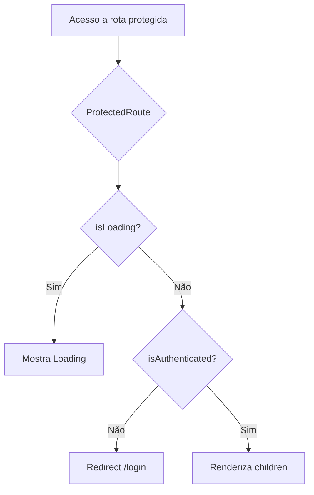
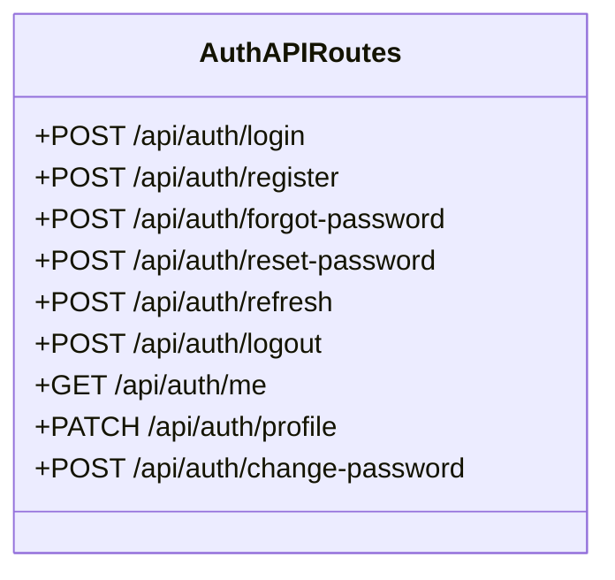
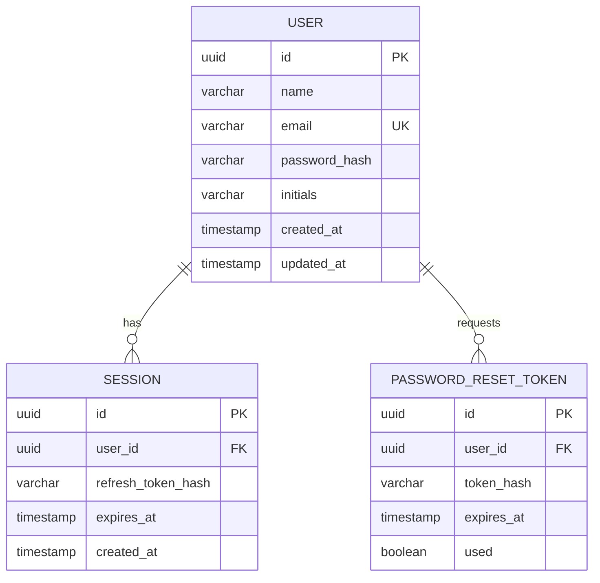

# Modelos de Dados — Everest Auth

> Documentação dos modelos de domínio com diagramas UML (Mermaid) e descrição de atributos/métodos.

---

## 📐 Diagrama de Classe — Interfaces TypeScript

```mermaid
classDiagram
    class User {
        +id: string
        +name: string
        +email: string
        +initials: string
        +createdAt: string
        +updatedAt: string
    }

    class LoginCredentials {
        +email: string
        +password: string
    }

    class RegisterData {
        +name: string
        +email: string
        +password: string
        +confirmPassword: string
    }

    class ForgotPasswordData {
        +email: string
    }

    class ResetPasswordData {
        +token: string
        +password: string
        +confirmPassword: string
    }

    class AuthResponse {
        +user: User
        +accessToken: string
        +refreshToken: string
        +expiresIn: number
    }

    class ApiError {
        +message: string
        +status: number
        +code?: string
    }

    class ChangePasswordData {
        +currentPassword: string
        +newPassword: string
    }

class UpdateProfileData {
        +name?: string
        +email?: string
    }

    AuthResponse --> User
    ```

    ## 🔐 Token Storage (Secure Storage)

    | Arquivo | Função | Descrição |
    |---------|--------|-----------|
    | `lib/secure-storage.ts` | `secureStorage` | Gerencia tokens via `document.cookie` com flags `Secure; SameSite=Strict` (simula httpOnly). Substitui `localStorage` para segurança XSS. |
    | `lib/csrf.ts` | `csrf` | Gera tokens CSRF aleatórios via `crypto.getRandomValues()`, validação double-submit cookie. |
    | `lib/validation.ts` | `validatePassword` | Valida senha: mínimo 8 caracteres, maiúscula, minúscula, número, caractere especial. |
    | `lib/rate-limit.ts` | `checkRateLimit`, `getRateLimitInfo` | Limiting de 5 requests/min por chave (IP/endpoint). Store em memória, interface para Redis. |

    ---

---

## 📋 Tabela de Interfaces

### `User` (lib/auth.ts)
| Atributo | Tipo | Descrição |
|----------|------|-----------|
| `id` | `string` | Identificador único (ex: `usr_demo`) |
| `name` | `string` | Nome completo do usuário |
| `email` | `string` | E-mail de acesso (único) |
| `initials` | `string` | Iniciais para avatar (ex: `MC`) |
| `createdAt` | `string` | ISO 8601 - Data de criação |
| `updatedAt` | `string` | ISO 8601 - Data de atualização |

---

### `LoginCredentials` (lib/auth.ts)
| Atributo | Tipo | Validação |
|----------|------|-----------|
| `email` | `string` | E-mail válido (Zod: `z.string().email()`) |
| `password` | `string` | Mín. 6 caracteres (Zod: `z.string().min(6)`) |

---

### `RegisterData` (lib/auth.ts)
| Atributo | Tipo | Validação |
|----------|------|-----------|
| `name` | `string` | Mín. 2 caracteres |
| `email` | `string` | E-mail válido |
| `password` | `string` | Mín. 6 caracteres |
| `confirmPassword` | `string` | Deve ser igual a `password` |

---

### `ForgotPasswordData` (lib/auth.ts)
| Atributo | Tipo | Validação |
|----------|------|-----------|
| `email` | `string` | E-mail válido |

---

### `ResetPasswordData` (lib/auth.ts)
| Atributo | Tipo | Validação |
|----------|------|-----------|
| `token` | `string` | Token de recuperação |
| `password` | `string` | Mín. 6 caracteres |
| `confirmPassword` | `string` | Deve ser igual a `password` |

---

### `AuthResponse` (lib/auth.ts)
| Atributo | Tipo | Descrição |
|----------|------|-----------|
| `user` | `User` | Dados do usuário autenticado |
| `accessToken` | `string` | JWT access token (mock) |
| `refreshToken` | `string` | JWT refresh token (mock) |
| `expiresIn` | `number` | Tempo de expiração em segundos (3600) |

---

### `ApiError` (lib/auth.ts + lib/api.ts)
| Atributo | Tipo | Descrição |
|----------|------|-----------|
| `message` | `string` | Mensagem de erro amigável |
| `status` | `number` | HTTP status code |
| `code?` | `string` | Código de erro interno (opcional) |

---

### `ChangePasswordData` (lib/auth.ts)
| Atributo | Tipo | Validação |
|----------|------|-----------|
| `currentPassword` | `string` | Senha atual |
| `newPassword` | `string` | Mín. 6 caracteres |

---

### `UpdateProfileData` (lib/auth.ts)
| Atributo | Tipo | Descrição |
|----------|------|-----------|
| `name?` | `string` | Novo nome (opcional) |
| `email?` | `string` | Novo e-mail (opcional) |

---

## 🔄 Fluxo de Dados (Sequence Diagram)

```mermaid
sequenceDiagram
    participant User as Usuário
    participant LoginPage as LoginPage
    participant useAuth as useAuth Hook
    participant authApi as authApi (lib/api.ts)
    participant API as API Routes (app/api/auth/*)
    participant LocalStorage as localStorage

    User->>LoginPage: Preenche email/password
    LoginPage->>useAuth: login(email, password)
    useAuth->>authApi: login({ email, password })
    authApi->>API: POST /api/auth/login
    API-->>authApi: { user, accessToken, refreshToken, expiresIn }
    authApi->>LocalStorage: setItem('access_token', ...)
    authApi->>LocalStorage: setItem('refresh_token', ...)
    authApi-->>useAuth: { user }
    useAuth->>useAuth: setUser(user)
    useAuth-->>LoginPage: void
    LoginPage->>Router: push('/dashboard')
```

---

## 🔐 Fluxo de Proteção de Rotas



---

## 🗄️ Mock API Routes (app/api/auth/*)



### Endpoints e Comportamento

| Endpoint | Método | Request Body | Response | Descrição |
|----------|--------|--------------|----------|-----------|
| `/api/auth/login` | POST | `LoginCredentials` | `AuthResponse` | Autentica usuário, retorna tokens |
| `/api/auth/register` | POST | `RegisterData` | `AuthResponse` | Cria conta, retorna tokens |
| `/api/auth/forgot-password` | POST | `ForgotPasswordData` | `{ message }` | Envia e-mail recuperação |
| `/api/auth/reset-password` | POST | `ResetPasswordData` | `{ message }` | Redefine senha via token |
| `/api/auth/refresh` | POST | `{ refreshToken }` | `{ accessToken, refreshToken, expiresIn }` | Renova tokens |
| `/api/auth/me` | GET | — | `User \| 401` | Retorna usuário autenticado |
| `/api/auth/logout` | POST | — | `{ message }` | Invalida sessão (mock) |
| `/api/auth/profile` | PATCH | `UpdateProfileData` | `User` | Atualiza nome/e-mail |
| `/api/auth/change-password` | POST | `ChangePasswordData` | `{ message }` | Altera senha |

---

## 🔧 API Client (lib/api.ts)

```mermaid
classDiagram
    class AuthApiClient {
        -API_BASE: string
        +login(credentials): Promise~AuthResponse~
        +register(data): Promise~AuthResponse~
        +forgotPassword(data): Promise~{message}~
        +resetPassword(data): Promise~{message}~
        +refreshToken(): Promise~{accessToken,refreshToken,expiresIn}~
        +getMe(): Promise~User | null~
        +logout(): Promise~void~
        +updateProfile(data): Promise~User~
        +changePassword(data): Promise~{message}~
    }

    class TokenStorage {
        +getAccessToken(): string | null
        +setAccessToken(token): void
            - Usa document.cookie com flags Secure; SameSite=Strict
        +getRefreshToken(): string | null
        +setRefreshToken(token): void
        +clearTokens(): void
    }

    class ApiError {
        +message: string
        +status: number
        +code?: string
    }

    class CsrfToken {
        +getToken(): string
        +getHeader(): Record<string, string>
        +validateToken(token): boolean
    }

    AuthApiClient --> TokenStorage
    AuthApiClient --> ApiError
    AuthApiClient --> CsrfToken
```

### Funções Principais

| Função | Descrição |
|--------|-----------|
| `request<T>(endpoint, options, token?, isRetry?)` | Helper genérico com auto-refresh em 401, attach CSRF header em métodos mutantes, credenciais 'include' |
| `getAccessToken()` | Lê `access_token` do `secureStorage` (document.cookie) |
| `setTokens(access, refresh, expiresIn)` | Salva tokens no `secureStorage` com expiry calculation |
| `clearTokens()` | Remove tokens do `secureStorage` |
| `csrf.getHeader()` | Retorna header `x-csrf-token` com token do cookie |

---

## 🎯 Como o Projeto Utiliza (Integração)

### 1. **Login / Register** (`app/login/page.tsx`, `app/register/page.tsx`)
```typescript
// Zod valida input bruto
const loginSchema = z.object({
  email: z.string().email(),
  password: z.string().min(6),
});

// Hook useAuth chama authApi.login()
const { login } = useAuth();
await login(email, password); // → authApi.login() → POST /api/auth/login

// Retorno da API (AuthResponse) → setUser(userDTO)
```

### 2. **AuthProvider** (`hooks/use-auth.tsx`)
```typescript
// Estado do usuário (User do backend)
const [user, setUser] = useState<User | null>(null);

// Carrega usuário no mount
async function loadUser() {
  const userData = await authApi.getMe(); // GET /api/auth/me
  setUser(userData);
}

// Login registra tokens + usuário
async function login(email, password) {
  const { user } = await authApi.login({ email, password });
  setUser(user); // User interface
}
```

### 3. **Profile Page** (`app/profile/page.tsx`)
```typescript
// Atualização de perfil
const profileForm = useForm({ resolver: zodResolver(profileSchema) });

async function onProfileSubmit(data) {
  await updateProfile(data); // → authApi.updateProfile() → PATCH /api/auth/profile
  await refreshUser(); // Recarrega do backend
}

// Alteração de senha
await authApi.changePassword({ currentPassword, newPassword });
```

### 4. **ProtectedRoute** (`hooks/use-protected-route.tsx`)
```typescript
export function ProtectedRoute({ children }) {
  const { isAuthenticated, isLoading } = useAuth();
  const router = useRouter();

  useEffect(() => {
    if (!isLoading && !isAuthenticated) router.replace('/login');
  }, [isAuthenticated, isLoading, router]);

  if (isLoading || !isAuthenticated) return <Loading />;
  return children;
}
```

---

## 📦 Persistência (Backend Real — Futuro)



---

## 📋 Resumo de Arquivos Relacionados

| Camada | Arquivo | Responsabilidade |
|--------|---------|------------------|
| **Types** | `lib/auth.ts` | Interfaces TypeScript (User, AuthResponse, etc.) |
| **API Client** | `lib/api.ts` | Cliente HTTP + token management + error handling |
| **Mock API** | `app/api/auth/*/route.ts` | Rotas Next.js simulando backend |
| **State** | `hooks/use-auth.tsx` | Estado global + ações de auth (AuthProvider) |
| **Guard** | `hooks/use-protected-route.tsx` | Proteção de rotas (redirect se não autenticado) |
| **Pages** | `app/*/page.tsx` | Páginas (forms, validação Zod, UI) |
| **Utils** | `lib/utils.ts` | Helpers (cn, formatDate, getInitials, etc.) |

---

## 🔑 Credenciais de Teste (Mock API)

```typescript
// Login válido
email: "demo@evereste.com"
password: "123456"

// Login inválido (retorna erro)
email: "erro@exemplo.com"
// ou password.length < 6

// Qualquer outro e-mail válido → cria usuário mock dinamicamente
```

---

*Documentação gerada em: 2026-10-06*
*Projeto: Everest Auth Module*
*Versão: 1.0.0*
*Arquitetura: Next.js 14 App Router + Radix UI + Tailwind CSS v3 + TypeScript*